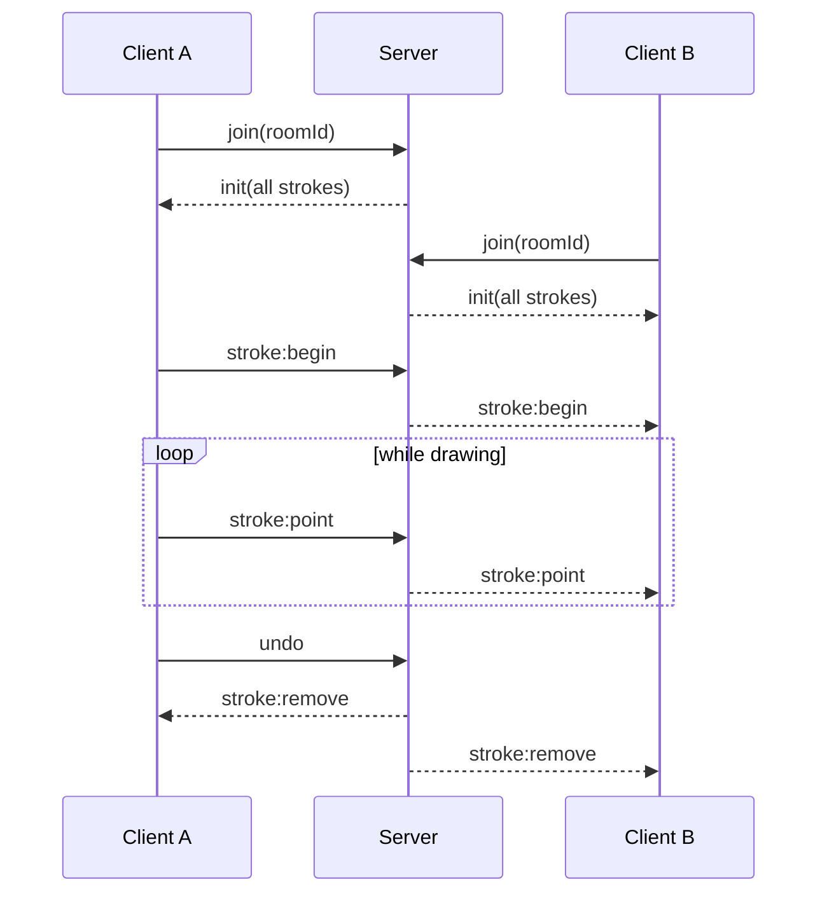

# Whiteboard


A real-time collaborative whiteboard. Open the same link in two tabs (or two devices) and draw together.

<!-- Add a screenshot or GIF here once you record one:

-->

**Stack:** React + TypeScript (Vite) · Node.js · Express · Socket.io · HTML Canvas

## Features

- **Live drawing sync**: strokes stream point by point, so others see them as you draw
- **Shareable rooms**: the room id lives in the URL (`/#room-id`); late joiners receive the full board
- **Live cursors** and an online-user count
- **Per-user undo** and a shared clear-board action
- **Server-side validation** of room ids, colors, sizes and coordinates
- **Resolution-independent**: coordinates are normalized (0 to 1), so every screen shows the same drawing
- **HiDPI aware** canvas that redraws on resize
- Integration tests and a CI workflow (GitHub Actions)

## Quick start

Requires Node.js 20 or newer.

```bash
# terminal 1: server on :3001
cd server
npm install
npm run dev

# terminal 2: client on :5173
cd client
npm install
npm run dev
```

Open <http://localhost:5173> in two windows and start drawing.

### Environment variables

Copy the `.env.example` files if you need to change the defaults.

| Variable | Where | Default | Purpose |
|---|---|---|---|
| `PORT` | server | `3001` | Port the server listens on |
| `CLIENT_ORIGIN` | server | `http://localhost:5173` | Allowed CORS origin (set to your deployed client URL) |
| `VITE_SERVER_URL` | client | `http://localhost:3001` | Socket.io server URL (set to your deployed server URL) |

### Scripts

| Folder | Command | What it does |
|---|---|---|
| `server` | `npm run dev` | Start with auto-reload (tsx) |
| `server` | `npm test` | Run integration tests (Vitest) |
| `server` | `npm run build` / `npm start` | Compile to `dist/` and run it |
| `client` | `npm run dev` | Start the Vite dev server |
| `client` | `npm run build` | Type-check and build for production |

## How it works



### Socket events

| Event | Direction | Payload |
|---|---|---|
| `join` | client → server | `roomId` |
| `init` | server → client | `Stroke[]` (full history) |
| `stroke:begin` | both | `{id, color, size, points:[[x,y]]}` |
| `stroke:point` | both | `{id, point:[x,y]}` |
| `undo` / `stroke:remove` | client → server / broadcast | `strokeId` |
| `clear` | both | none |
| `cursor` | both (volatile) | `{id, x, y}` |
| `cursor:leave` | server → client | `socketId` |
| `users` | server → client | `number` |

### Design decisions

- **Server is the source of truth** for undo and clear. The sender waits for the broadcast, so all clients stay consistent.
- **Volatile cursor events**: dropped packets are fine, so they never queue up.
- **Owner is set by the server** from the socket id, so a client cannot edit or undo another user's strokes.
- **Bounded memory**: each room keeps at most 5000 strokes and 5000 points per stroke, and empty rooms are deleted.

## Project structure

```
whiteboard/
├── client/                 React + Vite frontend
│   └── src/
│       ├── App.tsx         Reads/creates the room id from the URL hash
│       └── Board.tsx       Canvas drawing, socket handling, toolbar
├── server/                 Express + Socket.io backend
│   ├── src/
│   │   ├── app.ts          Socket handlers and input validation
│   │   ├── rooms.ts        In-memory room and stroke store
│   │   └── index.ts        Entry point
│   └── tests/sync.test.ts  Integration tests
└── .github/workflows/      CI (test and build both apps)
```

## Known limitations

- Boards live in server memory, so they are lost when the server restarts.
- Undo is tied to the socket id; after a reconnect, earlier strokes can no longer be undone by that user.
- Anyone in a room can clear the board (no confirmation or permissions yet).
- No rate limiting per socket yet.

## Roadmap

- [ ] Persist boards (Redis / PostgreSQL)
- [ ] Shapes, text, eraser, PNG export
- [ ] Rate limiting per socket
- [ ] Clear confirmation and room permissions
- [ ] Docker setup and deploy (Render/Railway for the server, Vercel for the client)

## License

MIT © 2026 Hania Batool. See [LICENSE](LICENSE).
